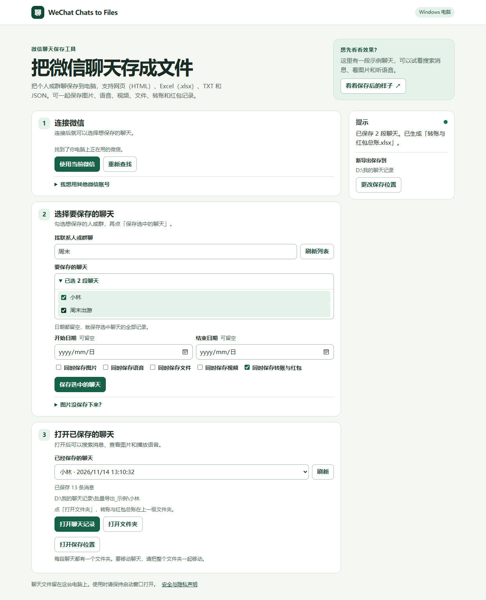

# WeChat Chats to Files · 微信聊天记录保存工具

把个人或群聊保存到电脑，支持 **网页（HTML）、Excel（.xlsx）、TXT 和 JSON**。可一起保存图片、语音、视频、文件和转账红包记录，语音可在本机转成文字。

适用于使用 Intel 或 AMD 处理器的 64 位 Windows 电脑和电脑版微信 4.x。

**[下载 Windows 免安装版](https://github.com/Lostforest7/wechat-chats-to-files/releases/latest/download/WeChat-Chats-to-Files-Windows-x64.zip)**

运行环境已包含在下载包里。

从旧版升级时，先关掉旧启动窗口，再打开新版。第 3 步仍可打开原来保存的聊天。

## 第一次使用

1. 点上方的 **下载 Windows 免安装版**。右键下载的 ZIP，选择 **全部解压缩**。
2. 在解压后的文件夹里双击 **启动 WeChat Chats to Files.cmd**。浏览器打开后，请保持启动窗口开启。
3. 登录电脑版微信，在工具页面点 **安装读取助手**，安装完成后点 **使用当前微信**。

首次安装读取助手需要联网，下载约 12 MB。页面上的 **看看保存后的样子** 可以打开一段示例聊天。

### 页面提示「第一次连接微信」时

这一步可能需要管理员权限。

1. 关闭工具原来的启动窗口。在解压后的文件夹里右键 **启动 WeChat Chats to Files.cmd**，选 **以管理员身份运行**，确认 Windows 的权限提示。
2. 在新打开的页面上点 **使用当前微信**，再点 **开始连接**。
3. 从屏幕右下角的微信图标菜单选择 **退出微信**。等几秒后重新打开微信，登录同一个账号，等待工具显示已连接。

连接成功后，平时可以双击正常打开。

## 保存聊天

1. 在第 2 步展开 **要保存的聊天**，勾选一个或多个联系人或群。日期留空会保存选中聊天的全部记录。
2. 如需换文件夹，点 **更改保存位置**。勾选想一起保存的内容，再点 **保存选中的聊天**。
3. 在第 3 步点 **打开聊天记录** 阅读，或点 **打开文件夹** 找到 Excel 和其他文件。

勾选 **同时保存转账与红包** 会生成 **转账与红包总账.xlsx**。批量保存时，总账在各段聊天的上一级文件夹。收支汇总只计算金额、收付款双方和收款状态都能从聊天确认的记录。红包金额未留在聊天里时，明细会标出缺失。

更改保存位置后，新导出会保存到新文件夹，旧导出仍可在列表里打开。要移动或分享，请把整个聊天文件夹一起复制。手机上才有的记录，请先通过微信的「聊天记录管理」导入电脑。

## 语音转文字

在第 3 步选择已保存的聊天，点 **把语音变成文字**。首次使用会自动下载约 600 MB，之后在本机转写。工具会逐条识别中文和英文，文字显示在语音下面。

转写完成后会更新导出的 Excel。转写前请先关闭已打开的表格。

## 安全与隐私

**聊天记录、附件、语音、转写结果和读取密钥都留在这台电脑上。** 项目没有收集聊天数据的服务器，也没有使用统计。首次需要联网下载读取助手或转写组件，聊天内容不随下载请求发送。[查看安全与隐私声明](PRIVACY.md)

## 常见问题

- **Windows 显示「无法验证发布者」**。当前免安装版的 `.cmd` 启动文件尚未签名。请核对文件来自本项目的 GitHub 发布页。管理员权限提示会在你主动选择「以管理员身份运行」时出现。
- **双击后页面没打开**。保持启动窗口开启，把窗口里显示的地址复制到浏览器。如果提示旧版正在运行，先关闭原来的启动窗口。
- **安装读取助手失败**。点 **安装读取助手** 重试。也可以展开 **安装遇到问题**，下载 WeFlow ZIP 后选择该文件。
- **找不到微信**。确认电脑微信已经登录，点 **重新查找**。还找不到时，展开 **我想用其他微信账号 → 找不到我的微信**，按提示填写微信的聊天保存位置。
- **图片、语音或文件没有保存**。先在电脑版微信里打开缺失的图片或语音、下载需要的文件，再保存一次聊天。
- **语音组件下载中断**。再次点 **把语音变成文字**，工具会尝试继续下载。已完成的转写也会在相同语言选项下复用。

## 开发与许可

项目源码使用 [MIT 许可证](LICENSE)。读取助手 WeFlow 使用 CC BY-NC-SA 4.0，包含非商业使用限制，详见 [第三方组件说明](THIRD_PARTY_NOTICES.md)。

欢迎查阅 [开发指南](CONTRIBUTING.md)。聊天导出已在电脑版微信 4.1.15.56 上验证。
